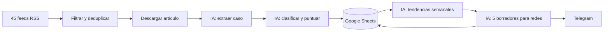

# Vigilancia continua de innovación con IA

[](https://github.com/jaimegp03/vigilancia-innovacion-ia/actions/workflows/ci.yml)
[](LICENSE)

-brightgreen)

Sistema en **n8n** que cada día lee revistas y medios de IA e innovación, descarta lo irrelevante y lo ya visto, extrae **casos concretos** de empresas que usan IA, los clasifica y puntúa, y cada semana genera un **informe de tendencias** y **borradores para redes sociales** que llegan por **Telegram** para revisarlos. Nada se publica solo.

> **English summary.** n8n workflows that monitor ~45 RSS sources daily, extract and score real-world enterprise AI use cases with an LLM (Gemini free tier by default, Claude optional), store them in Google Sheets, and send a weekly trends report plus social-media drafts via Telegram. Config-driven (sources, prompts, models, sector focus), Spanish-first, runs locally with Docker. Documentation is mainly in Spanish.

> 👋 **¿No eres técnico?** Empieza por la [**Guía sencilla**](docs/guia-sencilla.md).

## Cómo funciona



| Workflow | Cuándo | Qué hace |
|---|---|---|
| [`01_ingesta_diaria`](workflows/01_ingesta_diaria.json) | Diario, 07:00 | Lee feeds → filtra → deduplica → descarga → extrae y puntúa con IA → guarda en la hoja `casos`. |
| [`02_informe_semanal`](workflows/02_informe_semanal.json) | Lunes, 08:00 | Tendencias de la semana + 5 borradores (LinkedIn y X) → hojas y Telegram. |
| [`03_descubrimiento_semanal`](workflows/variante_claude/03_descubrimiento_semanal.json) | Miércoles *(opcional, solo con Claude)* | Búsqueda web de casos fuera de las fuentes fijas. |

Detalles de diseño en [docs/arquitectura.md](docs/arquitectura.md).

## Características

- **Gratis por defecto:** Google Gemini (capa gratuita). Variante de pago con Claude en [`workflows/variante_claude/`](workflows/variante_claude/).
- **Todo por configuración:** fuentes ([`config/fuentes.json`](config/fuentes.json)), modelos, pesos y límites ([`config/parametros.json`](config/parametros.json)), prompts ([`prompts/`](prompts/)). Cambiarlos no exige reimportar nada.
- **Salida JSON validada** contra un [esquema](schemas/caso.schema.json) con reintento y registro de descartes.
- **Preparado para modo sectorial** (banca, salud, automoción…) cambiando solo la configuración.
- **Almacenamiento aislado** para pasar de Google Sheets a Postgres.
- **Respetuoso con las fuentes:** resúmenes con palabras propias; no se guarda el texto de los artículos.
- **Probado:** pruebas unitarias, workflows con IA simulada y ejecuciones reales verificadas.

## Inicio rápido

Requisitos: Docker y, para modificar o probar, Node.js 20+.

```bash
cp .env.example .env     # rellena N8N_ENCRYPTION_KEY, GOOGLE_SHEET_ID y TELEGRAM_CHAT_ID
docker compose up -d     # n8n en http://localhost:5678
```

Después crea las credenciales (Gemini, Google Sheets, Telegram) e importa los workflows. Guía completa paso a paso: **[docs/instalacion.md](docs/instalacion.md)**.

## Documentación

| Documento | Contenido |
|---|---|
| [Guía sencilla](docs/guia-sencilla.md) | Para quien no es técnico: qué hace, rutina semanal, glosario. |
| [Instalación](docs/instalacion.md) | Credenciales, hojas de Google, importación y activación, elección de IA. |
| [Configuración](docs/configuracion.md) | Modo sectorial, fuentes, modelos, formato de hojas y mensajes, Postgres. |
| [Arquitectura](docs/arquitectura.md) | Qué hace cada pieza y por qué se diseñó así. |
| [Pruebas](docs/pruebas.md) | Cómo ejecutar los tests y qué se ha verificado. |
| [Problemas frecuentes](docs/solucion-de-problemas.md) | Limitaciones conocidas y errores habituales. |

## Estructura del repositorio

```
config/              fuentes, parámetros y consultas de descubrimiento
prompts/             un prompt por tarea de IA
schemas/             esquema JSON de casos, tendencias y borradores
workflows/           workflows de n8n listos para importar (Gemini)
  variante_claude/   los mismos con Claude (incluye el 03)
  utilidades/        formato de las hojas de Google Sheets (un solo uso)
plantilla_sheets/    cabeceras CSV de las 5 hojas
scripts/             generadores de workflows, nodos de código y utilidades
tests/               pruebas unitarias y workflows de prueba con IA simulada
docs/                documentación
```

Los workflows se **generan** desde `scripts/` (`npm run generar`); consulta [CONTRIBUTING.md](CONTRIBUTING.md) antes de modificarlos.

## Seguridad y privacidad

El repositorio no contiene claves: las credenciales viven solo en tu n8n y el `.env` está ignorado por git. Ver [SECURITY.md](SECURITY.md). En la capa gratuita de Gemini, Google puede usar los datos enviados para mejorar sus productos (aquí solo se envían artículos públicos).

## Aviso

Respeta los términos de uso de cada medio. Revisa siempre los borradores y verifica las cifras con la fuente original antes de publicar.

## Licencia

[MIT](LICENSE).
